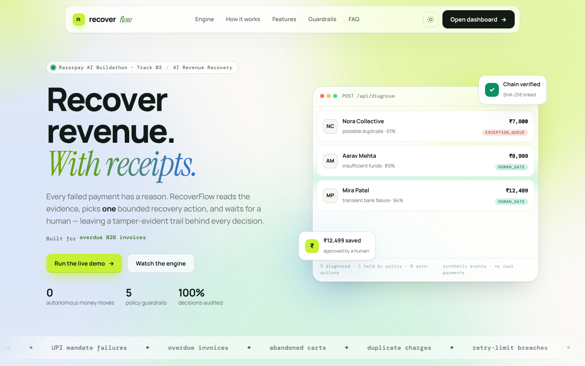
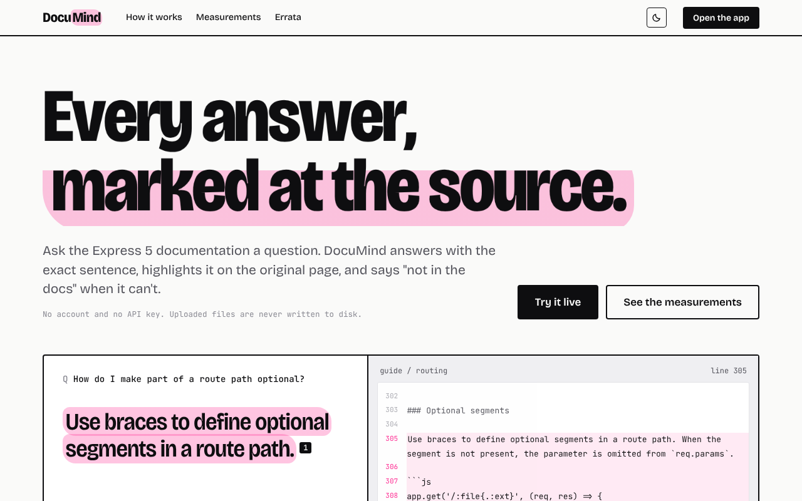
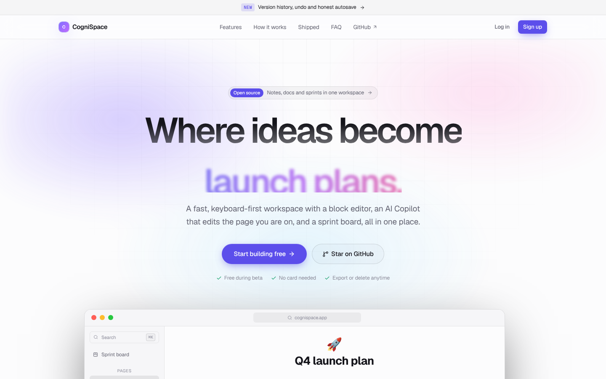
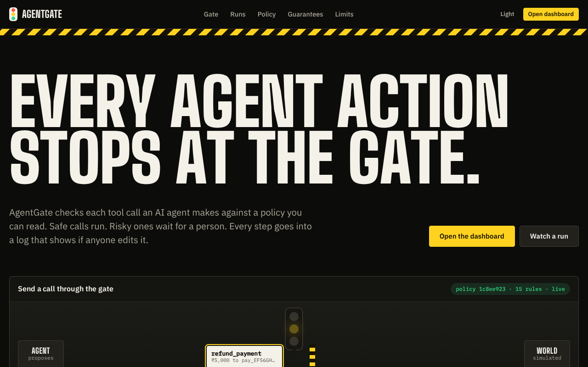

# Karthik Uppari

I build backend-heavy web products and ship them live. B.Tech CS (AI/ML) at NIAT, Hyderabad (2025–2029).
Looking for internships at product companies and early-stage startups: remote, Hyderabad or San Francisco.

[Portfolio](https://karthikuppari.vercel.app) · [LinkedIn](https://www.linkedin.com/in/karthik-uppari-4005a7373) · upparikarthik505@gmail.com

<table>
<tr>
<td width="50%"></td>
<td width="50%"></td>
</tr>
<tr>
<td></td>
<td></td>
</tr>
</table>

## Projects

**[RecoverFlow](https://recoverflow-ten.vercel.app)**: when a Razorpay payment fails, it works out why and proposes one safe next step. A person approves anything risky, and every decision goes into a tamper-evident log.

- Each webhook is processed exactly once in PostgreSQL. A test fires 200 copies of one event at the same moment and checks that exactly one is recorded.
- Found a rule that read "Refund" as "insufficient funds". Fixing it took diagnosis on 47 hand-written cases from 72.3% to 97.9%.
- Node.js, PostgreSQL, Razorpay webhooks (Test Mode) · [code](https://github.com/karthik1122-code/recoverflow)

**[DocuMind](https://documind-opal-alpha.vercel.app)**: ask a question about documentation and get the exact sentence, highlighted on the original page, or an honest "not in the docs".

- Hybrid search (BM25 + LSA) written from scratch. On a 50-question test set it finds the right passage in the top 5 for 91.4% of answerable questions; 15 more questions test that it refuses.
- Node.js, no runtime dependencies · [code](https://github.com/karthik1122-code/documind)

**[CogniSpace](https://cognispace-sigma.vercel.app)**: notes and a sprint board in one workspace, with an AI Copilot that edits the page you are on.

- Autosave says "Saved" only after the server confirms, and version checks stop two tabs overwriting each other.
- React, Express, MongoDB, Gemini · [code](https://github.com/karthik1122-code/cognispace)

**[AgentGate](https://agentgate-lake.vercel.app)**: a safety gate for AI agents. Every tool call is checked against a readable JSON policy, risky calls wait for a person, and everything is logged.

- Node.js, PostgreSQL · [code](https://github.com/karthik1122-code/agentgate)

**[SpendLog](https://spendlog-e525.onrender.com)**: an expense tracker that shows where the month's money went.

- React, Express, MongoDB, JWT sign-in · [code](https://github.com/karthik1122-code/spendlog)

## How I work

- I write the test or the evaluation first, and I publish the limits next to the results.
- I use AI coding tools heavily, then review, test and debug what they write.

## Experience

| When | What |
|---|---|
| Aug–Sep 2024 | IoT & Robotics Trainee, T-Works: AI-based smart street lights |
| Apr–Jul 2024 | Student Intern, Airbac Labs: machine learning for stock prediction |
| Aug 2024 | Volunteer, Rubaroo: STEM awareness for 100+ students |

**Stack:** JavaScript, Python, C++, SQL · React, Node.js, Express · PostgreSQL, MongoDB · Gemini API · Git, Docker, Vercel, Render
